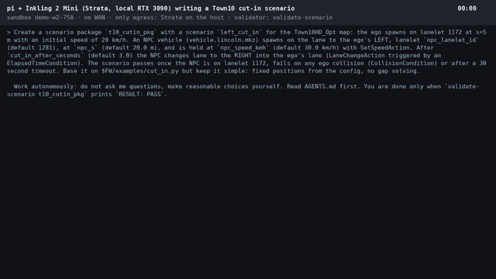
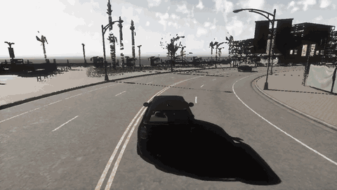
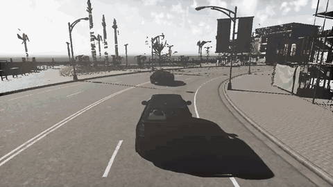
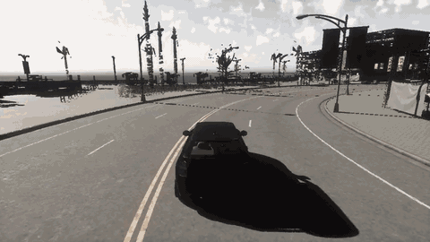

# autoware_carla_scenario_sandbox

An OpenShell + Docker sandbox in which a coding agent writes scenarios for
[autoware_carla_scenario](https://github.com/autowarefoundation/autoware_carla_scenario)
(PyPI `autoware-carla-scenario`; the version is selectable, default 29.3.11). It also
evaluates the local model **Inkling 2 Mini**, served by [Strata](https://github.com/Niko1221/Strata) and driven by the
[pi](https://www.npmjs.com/package/@mariozechner/pi-coding-agent) harness, on a single RTX 3090.



*Inkling 2 Mini writing a Town10 cut-in scenario in the sandbox, replayed from the recorded pi event stream (80 s shown at about 4 fps).*

## Results

The scenarios the agent wrote, run on CARLA 1.0 (Town10HD_Opt, chase camera, TrafficManager-driven ego):

| w1: stop behind a parked car | w2: cut-in from the left lane | w3: drive under a speed cap (2x speed) |
|---|---|---|
|  |  |  |
| PASSED in 8.75 s | PASSED in 4.15 s | PASSED in 21.10 s |

Each trial runs in a fresh sandbox. Offline grading checks that `validate-scenario` passes, that the required
classes are used and that the YAML holds the requested values. The skill closed loop is graded by the agent's own
last CARLA run (`*_result.json`).

| Suite | Prompt language | Passed | Seconds per trial | Turns |
|---|---|---|---|---|
| Nishishinjuku, deterministic decoding | English | 9 / 9 | 36–205 | 8–19 |
| Nishishinjuku, temperature 1.0, seed per trial | English | 12 / 12 | 35–137 | 7–21 |
| Town10HD_Opt w1–w3, temperature 1.0 | English | 8 / 9 | 61–95 | 11–20 |
| Town10HD_Opt j1–j3 (same tasks, same seeds) | Japanese | 8 / 9 | 116–385 | 7–20 |
| Town10HD_Opt w1–w3, rerun as a control for the Japanese suite | English | 9 / 9 | 111–779 | 9–40 |
| Skill closed loop: `/skill:write-scenario`, then `debug-concrete-scenario` in CARLA until PASSED | Japanese | 2 / 2 | 934–1062 | 41–42 |
| Skill closed loop, same task | English | 2 / 2 | 597–1049 | 31–44 |

* The prompt language made no difference to the success rate. With Japanese instructions the agent still read
  the skills on its own initiative and wrote its final report in Japanese.
* The English control and the closed loop ran on the image with `context-trim.ts` (see below), and the earlier
  rows ran without it. Their time and turn counts are therefore not strictly comparable.
* All four closed-loop trials reached PASSED on their first CARLA run.

## Architecture

```
host ─────────────────────────────────────────────────────────────────────────────
  OpenShell gateway 0.1.10 (docker compose, :8080) ── Docker driver ──┐
  Strata 0.2.21 container (Inkling-2-Mini SQ-20, RTX 3090)            │
     127.0.0.1:18080 / docker0:18080  ◀── LLM egress ──────────────┐  │
  CARLA 1.0 nightly (:2000-2002)      ◀── CARLA egress (python) ─┐ │  │
                                                                 │ │  ▼
  ┌─ sandbox "scenario-author" (image autoware-carla-scenario-sandbox:<version>) ┐
  │ user sandbox (uid 1000), Landlock: rw /sandbox,/tmp; ro /usr,/etc,...        │
  │ network: default deny; provider `strata` allows node+curl ->                 │
  │          host.openshell.internal:18080, API key injected by the proxy;       │
  │          policy rule `carla` allows the venv python -> :2000-2002            │
  │ /sandbox/workspace: pre-synced venv (framework + Codon toolchain), maps,     │
  │   docs, AGENTS.md, .agents/skills (all six upstream skills),                 │
  │   bin/{lanelet-info,validate-scenario,carla-status}, pi (harness)            │
  └──────────────────────────────────────────────────────────────────────────────┘
```

## Why this shape

* **What a scenario is.** A scenario is a scenario package (`scenario-new` scaffold):
  a `BaseScenario` subclass, a config dataclass and Hydra YAML, registered through
  an entry point. All positions are Lanelet2 (`lanelet_id`, `s`).
* **What can be checked without CARLA.** The framework's `scenario-check` compiles
  the scenario with Codon using the YAML's values. It catches type errors, unknown
  config keys and bad values. `validate-scenario` adds three steps around it:
  an offline install, a check that every lanelet ID exists and can be spawned on,
  and the package's own tests. This gives the agent a short, deterministic feedback
  loop. When a CARLA server is up on the host, the debug skills also run the scenario.
* **No WAN.** Everything the agent needs is baked into the image: the venv,
  typesafe-carla's prebuilt client, the Codon toolchain, the uv cache with
  `uv_build`, the maps, the docs and pi. The only destinations are the LLM (for `node` and `curl`) and
  the host CARLA ports (for the venv's python). The real Strata key never enters the sandbox; the proxy swaps
  the placeholder.
* **Harness: pi.** Its system prompt is small and it has four tools
  (read/bash/edit/write). Inkling 2 Mini runs with a 32k context and 3.4B active
  parameters. Claude Code's or OpenCode's prompt and tool schemas would eat a large
  part of that window. pi reads `AGENTS.md` and Agent-Skills dirs, so the upstream
  skills work unchanged.

## Use

```bash
# 0. machine-specific paths (git-ignored), e.g.
cat > local.env <<'EOF'
CARLA_PKG=/path/to/Carla-1.0-Linux-Shipping   # contains CarlaUnreal.sh
STRATA_DATA=/path/to/strata-data              # ~19 GB of weights, downloaded once
EOF
mkdir -p .secrets && openssl rand -hex 24 > .secrets/strata_api_key

# 1. gateway (OpenShell 0.1.10 CLI from the GitHub release)
docker compose -p scenario-sandbox-openshell -f gateway/docker-compose.yml up -d
# 2. model server
scripts/strata-up.sh            # wait for: curl -s 127.0.0.1:18080/health
# 3. image + sandbox, for the framework version you want
AUTOWARE_CARLA_SCENARIO_VERSION=29.3.11 scripts/build-image.sh
AUTOWARE_CARLA_SCENARIO_VERSION=29.3.11 scripts/sandbox-up.sh   # provider profile + provider + sandbox "scenario-author"
# 4. work in it
openshell sandbox connect scenario-author     # then: pi
#    or headless:
openshell sandbox exec --name scenario-author -- bash -lc 'pi -p "/skill:write-scenario ..."'
# 5. evaluation (fresh sandbox per trial; results in eval/results/<ts>/)
python3 eval/run_eval.py --suite town10 --trials 3 --seed-base 300
python3 eval/run_eval.py --suite town10-ja --trials 3 --seed-base 300
CARLA_RENDER=0 scripts/carla-up.sh && python3 eval/run_eval.py --suite skills --trials 2 --seed-base 500
```

### Selecting the framework version

`AUTOWARE_CARLA_SCENARIO_VERSION` (default in `scripts/env.sh`) controls all of these:

| What | Where |
|---|---|
| PyPI version installed in the image | Dockerfile `ARG AUTOWARE_CARLA_SCENARIO_VERSION` -> `image/workspace/pyproject.toml` |
| Git tag the map data and the skills' docs come from | `v<version>`, cloned to `.cache/` (or `AUTOWARE_CARLA_SCENARIO_SRC=<local clone>`) |
| Image tag | `autoware-carla-scenario-sandbox:<version>` (override with `SANDBOX_IMAGE`) |
| Host runner venv for `scripts/run-in-carla.sh` | `runner/.venv-<version>` |
| Image used by `eval/run_eval.py` and `scripts/sandbox-up.sh` | the same tag |

`AGENTS.md` and `tools/` are written against the 29.x API (Codon rules, `$FW` layout and
`scenario-new` / `scenario-check`). For another major version, check those first.

Get a finished package out with
`openshell sandbox download scenario-author /sandbox/workspace/<pkg> ./out`, then record it on the host:
`scripts/run-in-carla.sh ./out/<pkg> <scenario> ./run_out` (chase-cam video in `run_out/carla.mp4`).

## Skills and CARLA from inside the sandbox

All six skills shipped by the framework (`write-scenario`, `scenario-writing`, `debug-concrete-scenario`,
`scenario-debugging`, `review-scenario`, `scenario-review`) are in `/sandbox/workspace/.agents/skills/`. pi lists
them, and `/skill:<name> ...` works in interactive and `-p` mode. The skills need the following:

| The skill needs | Provided by |
|---|---|
| `<framework>/...` | the installed package (`$FW`) |
| `docs/<page>.md` | the docs of the selected tag baked into `/sandbox/workspace/docs/` |
| `uv run scenario-check / scenario-expand / scenario-new` | the offline venv |
| `uv run scenario` / `--multirun` (debug skills) | host CARLA via policy rule `carla` (raw TCP 2000-2002, Python only), `CARLA_HOST=host.openshell.internal` |
| `uv run viewer` | run it in the sandbox on 9100, then `openshell forward start 9100 scenario-author -d` -> http://127.0.0.1:9100 |

With rendering, the model and the simulator do not both fit in the 3090's VRAM. For the agent's debug loop, run
CARLA without rendering next to Strata:

```bash
CARLA_RENDER=0 scripts/carla-up.sh     # -nullrhi: TrafficManager ego, no sensors, ~0 VRAM
# record a video later: docker stop strata, CARLA_RENDER=1 scripts/carla-up.sh, scripts/run-in-carla.sh ...
```

pi checks for auto-compaction only when a prompt's run ends, so a long `pi -p` task overflows the 32k window
mid-run. `image/pi/extensions/context-trim.ts` trims old tool results before each LLM call
(`PI_TRIM_BUDGET`, default 18000 tokens). Without it, all four skill closed-loop trials died with HTTP 400. With it,
all four reached a PASSED CARLA run.

## Layout

| Path | What |
|---|---|
| `scripts/env.sh` | framework version, image tag; sources `local.env` |
| `gateway/` | upstream OpenShell docker deploy (config v2) + Linux `extra_hosts`; data in `/var/lib/openshell-scenario-sandbox` |
| `image/Dockerfile` | the sandbox image |
| `image/workspace/AGENTS.md` | the agent's instructions (workflow, Codon rules learned the hard way) |
| `image/workspace/tools/` | `lanelet-info`, `validate-scenario`, `carla-status` |
| `image/pi/` | pi provider/model config pointing at Strata; extensions `sampling.ts` (seeded sampling) and `context-trim.ts` |
| `policy/sandbox-policy.yaml` | filesystem/process policy + the `carla` TCP rule |
| `policy/strata-profile.yaml` | provider profile: the LLM egress |
| `runner/chase_cam.py` | host-side chase camera used by `scripts/run-in-carla.sh` |
| `eval/` | tasks (English, Japanese, skill closed loop), runner, demo recorder/renderer |
| `media/` | the GIFs above |

## Traps hit while building this

* The pinned `ghcr.io/nvidia/openshell/*:latest` images and older `gateway.toml` (v1) setups no longer work.
  The images moved to `quay.io/ai-openshell`, and the config is now `version = 2` with `compute_driver` singular.
  A 0.0.85 CLI fails against a 0.1.10 gateway with `workspace_scope is required`.
* PyPI `openshell` 0.1.x is only the Python SDK. The CLI is the static musl binary
  from the GitHub release.
* The workload does not get the image's `ENV` (only PATH), and `HOME` is the
  workdir. The env is in `/sandbox/sandbox.env`, which `.profile` sources, and
  `PI_CODING_AGENT_DIR` points pi at its config.
* Sandbox names are limited to 19 characters.
* `pkill -f` inside `openshell sandbox exec` matches and kills the exec's own shell.
* Strata's default port 8080 collides with the gateway, so it runs on 18080. The
  served model id is `inkling-2-mini-sq-20`. Without a request `seed`, Strata decodes deterministically, so
  `sampling.ts` adds temperature and a per-request seed (`--seed-base`).
